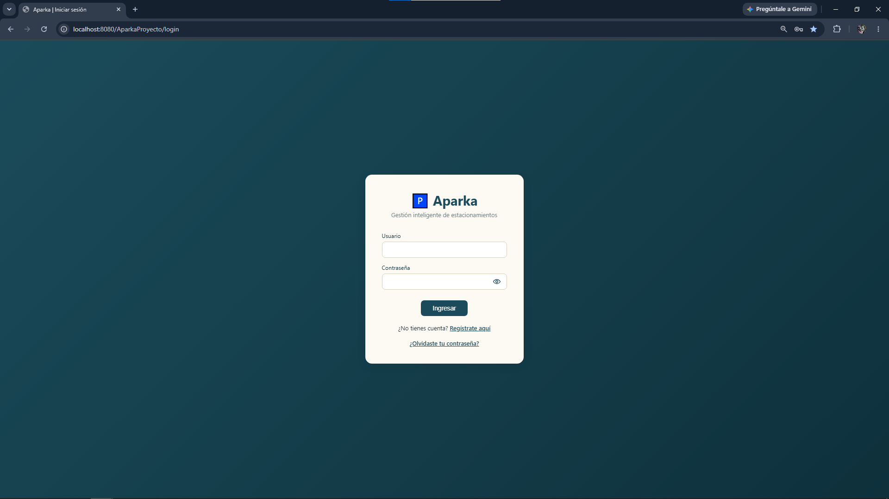
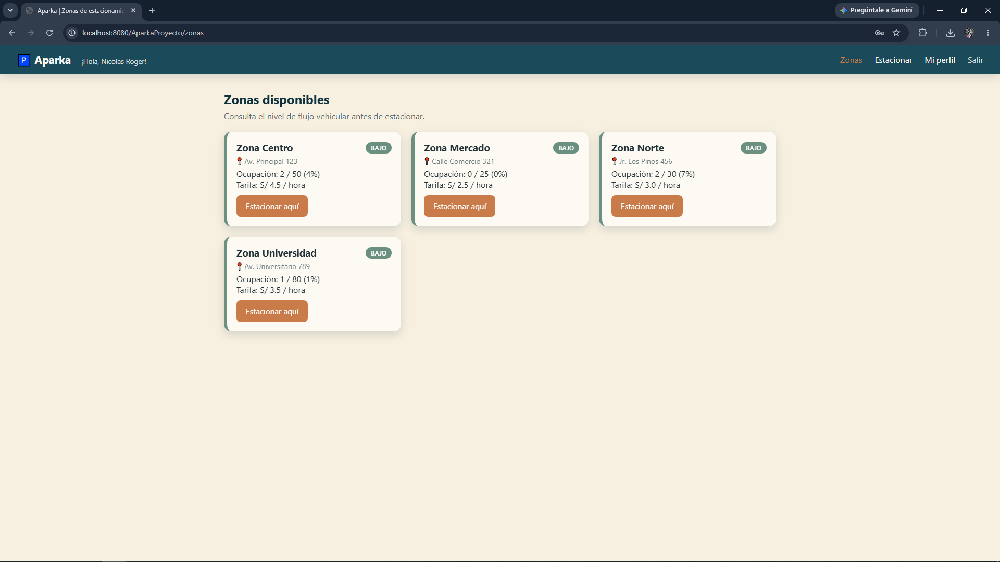
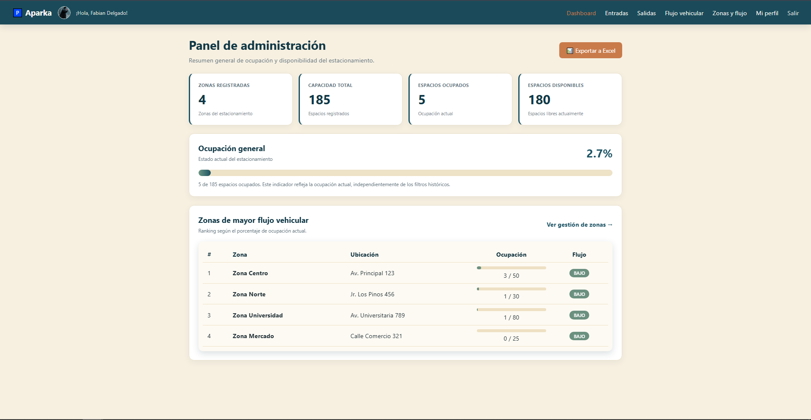

# APARKA — Sistema web de gestión de estacionamientos

Proyecto académico desarrollado en **Java (Servlets y JSP)** para gestionar operaciones de estacionamiento y consultar la ocupación y el flujo vehicular por zonas.

## Funcionalidades implementadas en el código

- **Autenticación:** inicio y cierre de sesión, registro y recuperación de contraseña.
- **Usuarios:** consulta de zonas, reserva, registro de entrada vehicular y edición de perfil/foto.
- **Administración:** dashboard, consulta de flujo vehicular, mapa de calor, gestión de zonas, registro de entradas y salidas, gestión de cajas y exportación de reportes Excel.

> El funcionamiento de cada módulo depende de contar con la base de datos y los servicios configurados. Esta lista describe módulos presentes en el repositorio, no una certificación de pruebas de extremo a extremo.

## Capturas disponibles

| Inicio de sesión | Zonas | Dashboard |
|---|---|---|
|  |  |  |

## Tecnologías

- Java 17 como versión objetivo de compilación (`pom.xml`); JDK 17 o superior compatible.
- Jakarta Servlet 6.0, JSP/JSTL, HTML, CSS y JavaScript.
- MySQL con JDBC y `PreparedStatement`.
- Apache Maven, empaquetado WAR y Apache Tomcat 11.
- JUnit 5 y Maven Surefire para pruebas automatizadas.

### Librerías solicitadas en APF3

| Librería | Uso verificable en el código |
|---|---|
| Google Guava | `Preconditions` en `com.aparka.util.ValidacionUtil` |
| Apache Commons Lang / Validator | `StringUtils` y `EmailValidator` en `ValidacionUtil` |
| Apache POI | `XSSFWorkbook` en `com.aparka.controller.ReporteExcelServlet` |
| Logback / SLF4J | Configuración `logback.xml` y registros de eventos desde controladores y utilidades |

Las dependencias están declaradas en `pom.xml`.

## Arquitectura y patrones

```text
src/main/java/com/aparka/
├── controller/  → Servlets: recepción de solicitudes HTTP
├── service/     → Servicios de aplicación (p. ej. ZonaService)
├── dao/         → Acceso a datos (p. ej. ZonaDAO, UsuarioSistemaDAO)
├── model/       → Entidades y modelos de dominio
└── util/        → Validación, conexión, seguridad y utilidades
src/main/webapp/
├── views/       → Vistas JSP
├── css/         → Estilos
└── js/          → Comportamiento de interfaz
```

- **MVC:** controladores Servlet, modelos Java y vistas JSP.
- **DAO:** consultas SQL encapsuladas en clases de acceso a datos.
- **SOLID:** existe separación de responsabilidades; la conformidad con cada principio debe argumentarse por clase y no se considera automáticamente demostrada por usar paquetes.
- **TDD:** existen pruebas automatizadas JUnit 5, pero el proceso *prueba antes que implementación* solo puede acreditarse mediante evidencias del historial de desarrollo.

## Instalación local

### Requisitos

JDK 17+, Maven, Tomcat 11 y MySQL. Para ejecutar módulos que envían correo, se requiere una cuenta SMTP configurada.

### 1. Obtener el proyecto

```bash
git clone https://github.com/Nicolas130599/AparkaProyecto.git
cd AparkaProyecto
```

### 2. Preparar MySQL

El repositorio incluye el archivo **`schema (1).sql`**, que crea la base `Parking` y sus tablas iniciales. Revisa el script y cualquier dato de demostración antes de ejecutarlo; úsalo solo en una base de prueba o con respaldo. La clase `InicializadorEsquema` verifica/agrega determinadas columnas al arrancar la aplicación, por lo que el script por sí solo no documenta todas las ampliaciones de esquema.

### 3. Configurar credenciales sin escribirlas en el código

La clase `ConexionBD` admite estas variables de entorno:

| Variable | Uso |
|---|---|
| `APARKA_DB_PASSWORD` | Contraseña del usuario MySQL |
| `APARKA_DB_USER` | Usuario MySQL; por defecto `root` |
| `APARKA_DB_URL` | URL JDBC opcional; por defecto intenta `localhost:3307` y `localhost:3306`, base `Parking` |
| `APARKA_EMAIL_PASSWORD` | Contraseña de aplicación para el correo SMTP, cuando corresponda |

En **PowerShell**, para la sesión actual (sin guardar contraseñas en archivos):

```powershell
$env:APARKA_DB_USER = "root"
$env:APARKA_DB_PASSWORD = Read-Host "Contraseña de MySQL"
# Opcional: $env:APARKA_DB_URL = "jdbc:mysql://localhost:3307/Parking?useSSL=false&serverTimezone=UTC"
```

Si necesitas enviar correos, configura `APARKA_EMAIL_PASSWORD` de manera segura antes de iniciar Tomcat. **Inicia Tomcat desde una consola que tenga acceso a estas variables**; los procesos ya abiertos no reciben automáticamente los cambios del entorno.

> El proyecto usa `aparkasystem@gmail.com` como remitente SMTP en `EmailUtil.java`. El envío debe probarse por separado; no se garantiza únicamente por compilar.

### 4. Compilar y desplegar

```bash
mvn clean package
```

Copia `target/AparkaProyecto.war` a `webapps/` de Tomcat 11, inicia Tomcat y visita:

`http://localhost:8080/AparkaProyecto/`

**No publiques credenciales ni cuentas de prueba reales en este documento.** Crea cuentas de prueba mediante el procedimiento de registro o mediante datos de prueba preparados para tu entorno.

## Pruebas

```bash
mvn test
```

El código contiene cinco clases de pruebas JUnit 5:

- `FotoPerfilUtilTest`
- `ValidacionUtilTest`
- `ResumenNivelTest`
- `MapaCalorTest`
- `ZonaTest`

En la última compilación comprobada durante el trabajo del equipo se reportaron **55 pruebas ejecutadas, 0 fallos y 0 errores**. Vuelve a ejecutar `mvn test` en tu entorno para obtener una evidencia actualizada.

## Seguridad: controles y aspectos por revisar

**Controles identificados:** contraseñas de usuarios con BCrypt (`PasswordUtils` y `UsuarioSistemaDAO`), consultas preparadas con JDBC, validaciones del lado del servidor y filtro de acceso a rutas `/admin/*` mediante `RoleFilter`.

**Revisiones pendientes:** protección CSRF en operaciones que modifican datos, endurecimiento de sesiones/cookies, controles de autorización en todos los endpoints y gestión segura de secretos. No se declara una auditoría de seguridad completa.

**Aviso importante:** el repositorio público tuvo credenciales reales en versiones anteriores. Retirarlas del código actual **no las elimina del historial**. Se deben revocar o rotar las contraseñas expuestas (MySQL y contraseña de aplicación de Gmail) y actualizar las variables de entorno. Si se decide limpiar el historial de Git, coordinarlo con el equipo y no reescribirlo sin un plan.

## Control de versiones

El proyecto se mantiene en GitHub mediante Git. La rama principal es `main`. Para mostrar avances al docente, conservar el historial de commits y documentar qué funcionalidades se entregaron en cada versión.

## Documentación del APF3

Los diagramas UML, la sustentación y los anexos académicos pueden entregarse por separado. Deben reflejar las clases y funcionalidades realmente presentes en este repositorio.

---

Proyecto académico APARKA.
