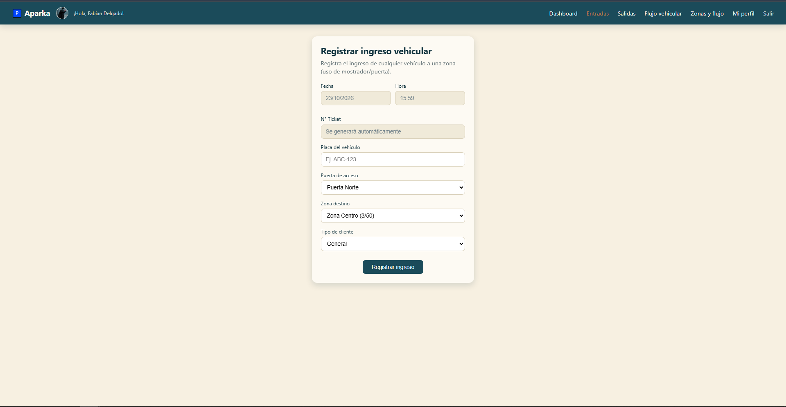
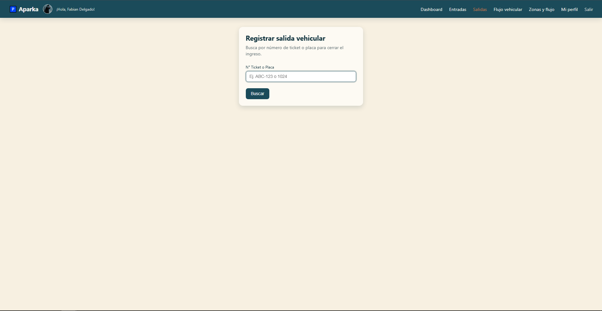
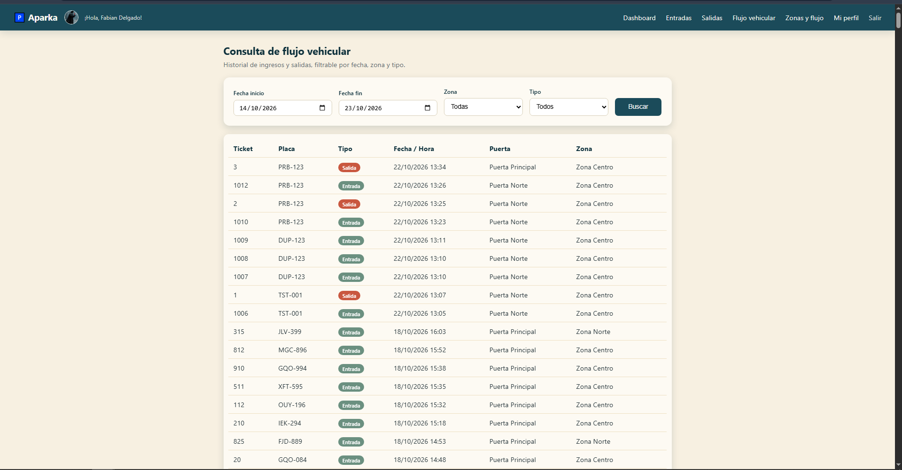
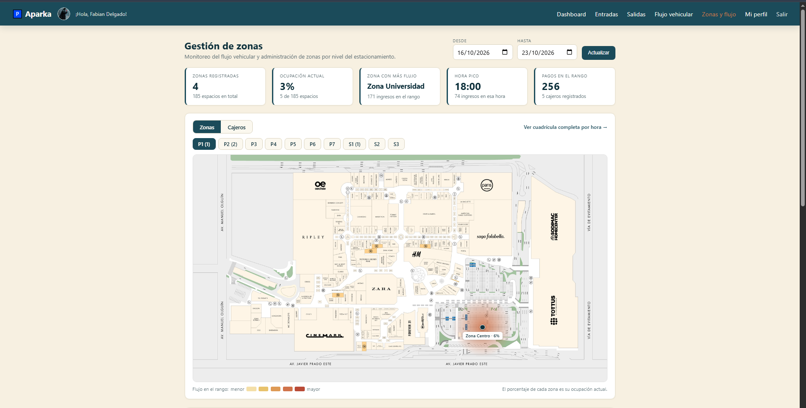
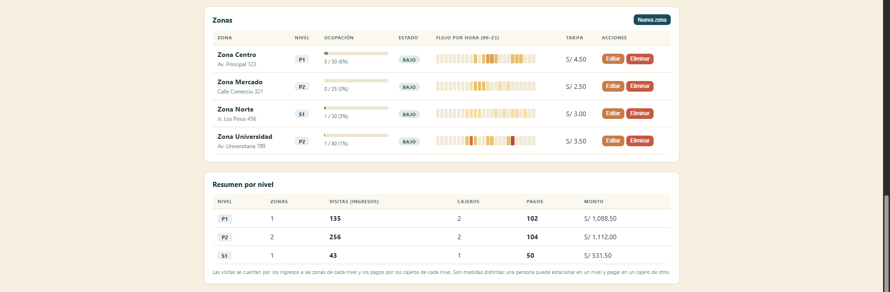
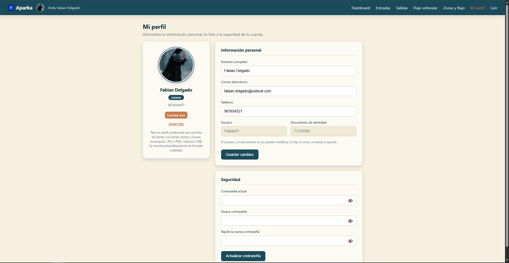
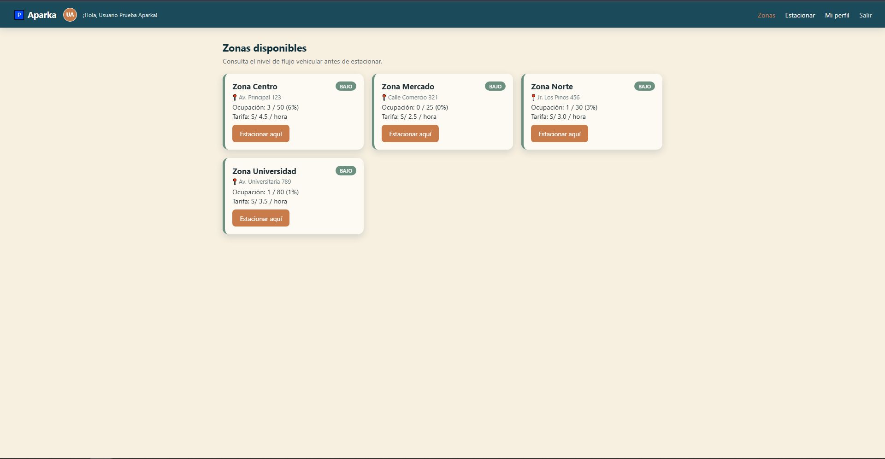
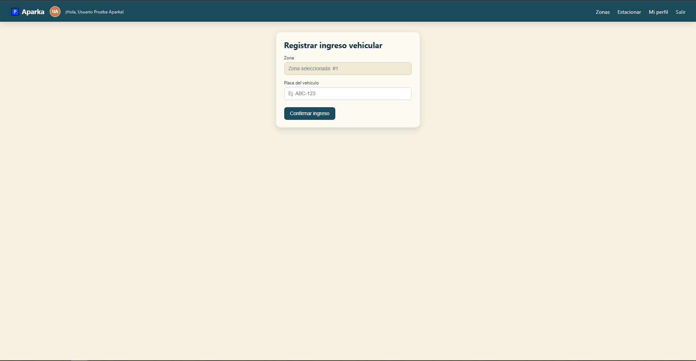
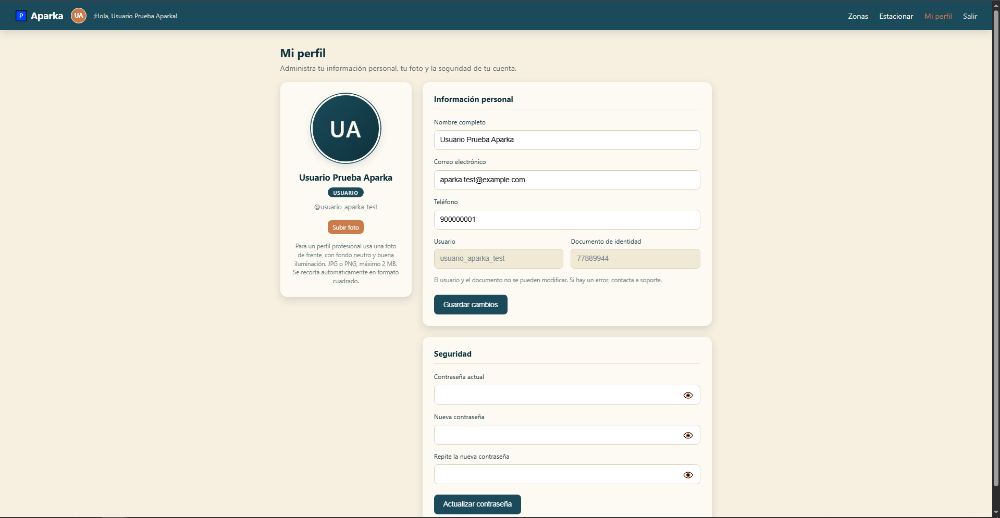

# 🅿️ APARKA — Sistema web de gestión de estacionamientos

**APARKA** es un proyecto académico desarrollado con **Java, Jakarta Servlets y JSP** para gestionar ingresos y salidas vehiculares, consultar disponibilidad y analizar el flujo de vehículos por zonas de estacionamiento.

     

> **Estado verificado el 23/10/2026:** el Pull Request [#3](https://github.com/Nicolas130599/AparkaProyecto/pull/3) se fusionó a `main`; `mvn clean verify` finalizó con **BUILD SUCCESS**, **80 pruebas**, **0 fallos**, **0 errores** y **0 omitidas**. Las verificaciones manuales realizadas abarcaron inicio de sesión, navegación básica por roles, cierre de sesión y bloqueo del dashboard administrativo sin autorización. Esto no constituye una auditoría de seguridad ni una prueba integral de todos los módulos.

## ✨ Funcionalidades

| Rol | Funcionalidades disponibles en el código |
|---|---|
| **Usuario** | Inicio y cierre de sesión, registro y recuperación de contraseña, consulta de zonas y tarifas, reserva, registro de ingreso vehicular y administración de perfil/fotografía. |
| **Administrador** | Panel de indicadores, registro de entradas y salidas, historial de flujo vehicular, mapa de calor, gestión de zonas y cajeros, administración de perfil y exportación de reportes Excel. |

## 📸 Galería de capturas

Las imágenes corresponden a una ejecución local de APARKA con datos de demostración. Las pantallas ilustran las interfaces; no acreditan por sí solas todas las operaciones de extremo a extremo.

### Acceso al sistema

**Inicio de sesión** — formulario de autenticación para los roles de usuario y administrador.


### Panel de administrador

**Dashboard** — capacidad, ocupación, disponibilidad y ranking de zonas.


| Registro de entradas | Registro de salidas |
|---|---|
|  |  |

**Flujo vehicular** — historial de ingresos y salidas con filtros por fecha, zona y tipo.



**Zonas y flujo** — indicadores, mapa de calor, gestión de zonas y cajeros.



| Gestión de zonas y resumen por nivel | Cajeros y módulos de pago |
|---|---|
|  |  |

**Perfil de administrador** — información personal, fotografía y opciones de cambio de contraseña.



### Panel de usuario

**Zonas disponibles** — consulta de ocupación, capacidad, tarifas y acceso al registro vehicular.



**Registrar ingreso vehicular** — formulario de placa con una zona previamente seleccionada.



**Perfil de usuario** — información personal, fotografía y opciones de seguridad de la cuenta.



## 🧰 Tecnologías

- **Java 17** como objetivo de compilación del proyecto; JDK compatible.
- **Jakarta Servlets, JSP/JSTL**, HTML, CSS y JavaScript.
- **MySQL** mediante JDBC y consultas parametrizadas con `PreparedStatement`.
- **Apache Maven**, empaquetado **WAR** y **Apache Tomcat 11**.
- **JUnit 5** y Maven Surefire para pruebas automatizadas.

### Librerías utilizadas

| Librería | Aplicación en APARKA |
|---|---|
| Google Guava | `Preconditions` en `ValidacionUtil` |
| Apache Commons Lang / Validator | `StringUtils` y `EmailValidator` en `ValidacionUtil` |
| Apache POI | `XSSFWorkbook` en `ReporteExcelServlet` |
| Logback / SLF4J | Configuración de registros y eventos de aplicación |
| jBCrypt | Hash y verificación de contraseñas en `PasswordUtils` |

Las dependencias se administran desde `pom.xml`.

## 🏗️ Arquitectura

```text
src/
├── main/
│   ├── java/com/aparka/
│   │   ├── controller/  # Servlets y solicitudes HTTP
│   │   ├── service/     # Servicios de aplicación
│   │   ├── dao/         # Acceso a datos
│   │   ├── model/       # Entidades y modelos
│   │   └── util/        # Validación, conexión y seguridad
│   └── webapp/
│       ├── views/       # Vistas JSP
│       ├── css/         # Estilos
│       └── js/          # Comportamiento del cliente
└── test/java/           # Pruebas JUnit
```

### Patrón MVC (Modelo–Vista–Controlador)

APARKA organiza la aplicación web por responsabilidades:

- **Modelo:** `com.aparka.model` incluye `Zona`, `Entrada` y `UsuarioSistema`, que representan información y, cuando corresponde, reglas de negocio.
- **Vista:** las páginas JSP y los recursos HTML/CSS/JavaScript presentan la información y los formularios.
- **Controlador:** los Servlets de `com.aparka.controller`, como `LoginServlet`, `RegistrarEntradaServlet` y `GestionZonaServlet`, reciben solicitudes HTTP y coordinan respuestas.

Esta separación facilita mantener la presentación independiente de los datos y del procesamiento de solicitudes.

### Patrón DAO (Data Access Object)

El paquete `com.aparka.dao` centraliza el acceso a MySQL. Por ejemplo, `ZonaDAO` implementa `listarTodas()`, `obtenerPorId()`, `insertar()`, `actualizar()` y `eliminar()` usando JDBC.

- Las consultas con parámetros utilizan `PreparedStatement`, por ejemplo `WHERE ZonaId = ?` con `ps.setInt(1, zonaId)`.
- `try-with-resources` cierra conexiones, sentencias y resultados.
- `mapear(ResultSet)` transforma las filas recuperadas en objetos `Zona`.
- `listarTodas()` calcula la ocupación real contando entradas sin salida (`TieneSalida = 0`), en lugar de depender de un contador manual almacenado en la tabla de zonas.

**Evidencia:** [`ZonaDAO.java`](src/main/java/com/aparka/dao/ZonaDAO.java).

### Principios SOLID: aplicación verificable

**Responsabilidad única (SRP)** es el principio SOLID que se puede ilustrar directamente con las clases revisadas:

| Clase | Responsabilidad principal |
|---|---|
| [`Zona.java`](src/main/java/com/aparka/model/Zona.java) | Representar una zona y calcular su porcentaje de ocupación y nivel de flujo. |
| [`ZonaService.java`](src/main/java/com/aparka/service/ZonaService.java) | Ofrecer operaciones de gestión de zonas y delegar la persistencia. |
| [`ZonaDAO.java`](src/main/java/com/aparka/dao/ZonaDAO.java) | Ejecutar consultas SQL y mapear los resultados a objetos del modelo. |

Por ejemplo, `ZonaService.crearZona(z)` delega en `zonaDAO.insertar(z)`: el servicio no contiene la instrucción SQL del `INSERT`. La distribución entre modelo, servicio y persistencia es **coherente con SRP** y mejora la organización y mantenibilidad.

**Alcance de la evidencia:** no se declara una implementación integral de los cinco principios SOLID. En particular, `ZonaService` instancia directamente `new ZonaDAO()`, por lo que este ejemplo no acredita inversión de dependencias (DIP). Otros principios deben demostrarse con clases específicas si el equipo los presenta en la sustentación.

### Pruebas unitarias y metodología TDD

El equipo identifica **TDD (Test-Driven Development)** como parte de su enfoque de desarrollo. En el repositorio se encuentran pruebas automatizadas con **JUnit 5**, que permiten comprobar comportamientos esperados y casos límite. La presencia de pruebas finales no acredita por sí sola el orden histórico **Red → Green → Refactor**.

**Ejemplo comprobado:** [`ZonaTest.java`](src/test/java/com/aparka/model/ZonaTest.java) valida los métodos `getPorcentajeOcupacion()` y `getNivelFlujo()` de [`Zona.java`](src/main/java/com/aparka/model/Zona.java):

| Escenario probado | Resultado esperado |
|---|---|
| 25 espacios ocupados de 50 | 50 % de ocupación |
| Capacidad total de 0 | 0 %, sin división por cero |
| 39 % de ocupación | `BAJO` |
| 40 % de ocupación | `MEDIO` |
| 79 % de ocupación | `MEDIO` |
| 80 % de ocupación | `ALTO` |
| 100 % de ocupación | `ALTO` |

Las pruebas usan `@Test`, `@ParameterizedTest`, `@CsvSource` y `assertEquals`; la clase `ZonaTest` aporta **10 ejecuciones** a la batería registrada. La clase de pruebas fue incorporada al historial en el commit [`12aaa16`](https://github.com/Nicolas130599/AparkaProyecto/commit/12aaa16), del **25/09/2026**. Ese commit demuestra su incorporación, pero no por sí mismo que la prueba antecediera a la implementación.

**Resultado global registrado:** 80 pruebas aprobadas, 0 fallos, 0 errores y 0 omitidas, al ejecutar `mvn clean verify` el 23/10/2026. Para sustentar el ciclo TDD estricto, el equipo deberá mostrar evidencia adicional de la secuencia prueba fallida → implementación mínima → refactorización, si la conserva.

## 🔐 Seguridad

Controles implementados en el código:

- **BCrypt:** almacenamiento de contraseñas como hashes y verificación mediante `PasswordUtils`.
- **CSRF:** validación de tokens en las rutas POST protegidas por `CsrfFilter`.
- **Validación de entradas:** reglas de formato y contenido en `ValidacionUtil`.
- **Autorización por rol:** `RoleFilter` restringe las rutas `/admin/*`.
- **Sesiones:** renovación del identificador de sesión tras autenticación exitosa.
- **Intentos de acceso:** limitación de intentos fallidos de inicio de sesión.
- **Base de datos:** consultas parametrizadas y operaciones transaccionales para controlar la capacidad de las zonas.
- **Secretos:** la conexión MySQL requiere variables de entorno, sin credenciales fijas en `ConexionBD`.

**Alcance:** los controles anteriores no equivalen a una auditoría de seguridad completa. Deben seguir revisándose los permisos de cada endpoint, la configuración de cookies/sesiones, el despliegue y la gestión de secretos.

> **Advertencia sobre el historial:** versiones anteriores del repositorio público contenían credenciales. Retirarlas del código actual no las elimina de los commits históricos. Es necesario **revocar o rotar** cualquier secreto expuesto, incluidas credenciales MySQL y SMTP. No reescribir el historial compartido sin coordinarlo con el equipo.

## 🧪 Pruebas automatizadas

Ejecutar desde la raíz del proyecto:

```bash
mvn clean verify
```

**Última ejecución verificada: 23 de octubre de 2026.**

| Clase de prueba | Pruebas | Fallos | Errores |
|---|---:|---:|---:|
| `EntradaDAOTest` | 3 | 0 | 0 |
| `MapaCalorTest` | 6 | 0 | 0 |
| `ResumenNivelTest` | 3 | 0 | 0 |
| `ZonaTest` | 10 | 0 | 0 |
| `FotoPerfilUtilTest` | 7 | 0 | 0 |
| `LoginAttemptLimiterTest` | 6 | 0 | 0 |
| `ValidacionUtilTest` | 45 | 0 | 0 |
| **Total** | **80** | **0** | **0** |

Resultado: **BUILD SUCCESS**, con **0 pruebas omitidas**. La compilación generó `target/AparkaProyecto.war`. Algunas pruebas requieren una base MySQL de pruebas aislada (`parking_test`); **no ejecutar pruebas que escriben datos contra la base de producción**.

## 🚀 Instalación local

### Requisitos

- JDK compatible con el objetivo Java 17 del proyecto.
- Apache Maven.
- Apache Tomcat 11.
- MySQL y una base de datos preparada para APARKA.
- Configuración SMTP, solo para las funcionalidades que envían correos.

### 1. Clonar

```bash
git clone https://github.com/Nicolas130599/AparkaProyecto.git
cd AparkaProyecto
```

### 2. Preparar la base de datos

El repositorio incluye `schema (1).sql`, que define una estructura inicial para `Parking`. **Revisar el script y respaldar los datos antes de ejecutarlo**. La aplicación incluye lógica adicional de actualización/verificación de esquema (`InicializadorEsquema`); por tanto, el script inicial no describe necesariamente todas las ampliaciones posteriores.

### 3. Configurar variables de entorno

`ConexionBD` **exige** las tres variables siguientes (sin valores por defecto):

| Variable | Descripción |
|---|---|
| `APARKA_DB_URL` | URL JDBC de la base de datos correspondiente al entorno |
| `APARKA_DB_USER` | Usuario de MySQL |
| `APARKA_DB_PASSWORD` | Contraseña del usuario de MySQL |

Para un ejemplo local con PowerShell (sustituir los valores según el entorno):

```powershell
$env:APARKA_DB_URL = 'jdbc:mysql://localhost:3307/Parking?serverTimezone=UTC'
$env:APARKA_DB_USER = Read-Host 'Usuario MySQL'
$env:APARKA_DB_PASSWORD = Read-Host 'Contraseña MySQL'
```

Estas asignaciones duran únicamente en la sesión actual. **Tomcat debe iniciarse desde un proceso que reciba las variables**; si se inicia mediante `startup.bat` desde otra sesión de Windows, verificar que ese proceso tenga acceso a ellas. No publicar valores reales en GitHub.

Para correo SMTP, configurar `APARKA_EMAIL_PASSWORD` de forma segura cuando corresponda. El envío de correo debe verificarse por separado.

### 4. Compilar y desplegar

```bash
mvn clean package
```

Copiar `target/AparkaProyecto.war` a la carpeta `webapps/` de Tomcat 11 y arrancar el servidor mediante `bin/startup.bat` en Windows. Acceder a:

```text
http://localhost:8080/AparkaProyecto/
```

En la verificación manual del 23/10/2026, el acceso sin sesión redirigió a `/AparkaProyecto/login`. La instalación de un nuevo WAR **no ocurre automáticamente** al compilar con Maven.

## 🌿 Control de versiones

- Repositorio: [Nicolas130599/AparkaProyecto](https://github.com/Nicolas130599/AparkaProyecto)
- Rama principal: `main`.
- Pull Request [#3 — Seguridad CSRF, validaciones y pruebas](https://github.com/Nicolas130599/AparkaProyecto/pull/3): **fusionado y cerrado el 23/10/2026**.
- Los cambios se verificaron en `main` con 80 pruebas JUnit satisfactorias.

## 📚 Documentación académica

Los diagramas UML, las evidencias y los anexos del APF3 pueden entregarse por separado. Deben reflejar las funcionalidades y el código realmente presentes en el repositorio.

---

**APARKA · Proyecto académico de Ingeniería de Sistemas.**
